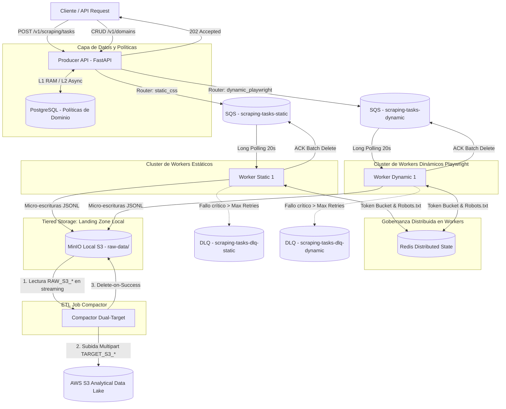

# Distributed High-Scale Scraping System

Sistema de ingesta y procesamiento de datos a gran escala diseñado bajo principios de arquitectura distribuida, microservicios, event-driven design, cumplimiento normativo y almacenamiento escalonado.

Su objetivo principal es permitir el procesamiento asíncrono de millones de URLs, garantizando alta disponibilidad, escalabilidad horizontal, estricta gobernanza legal por dominio, resiliencia y desacoplamiento total entre la captación de datos, su extracción y su almacenamiento analítico.

---

## 📌 Visión General

A diferencia de los scrapers tradicionales, este sistema utiliza el patrón **"Fire and Forget"** (`202 Accepted`).

El cliente envía una carga masiva de trabajo y recibe una respuesta instantánea con validación de contratos, mientras el sistema orquesta la distribución de tareas en segundo plano a través de colas de mensajería (Amazon SQS) segregadas por complejidad de renderizado, gobernadas por directivas de dominio y consolidadas en un lago de datos escalonado.

### Key Features

| Feature | Descripción |
| :--- | :--- |
| **Escalabilidad Horizontal** | Diseñado para manejar picos de tráfico distribuyendo la carga en workers independientes y desvinculados que consumen de forma concurrente con semáforos asíncronos. |
| **Gobernanza de Dominios & Compliance** | Control estricto de tasas de petición, respeto de `robots.txt` (RFC 9309) con caché TTL 24h, endpoints CRUD `/v1/domains` y resolución jerárquica de subdominios (`data.sec.gov` ➔ `sec.gov` ➔ `default`). |
| **Almacenamiento Escalonado (Tiered Storage)** | Landing Zone local en **MinIO** (a coste 0€ en VPS Hetzner o clúster K8s) para micro-escrituras ultrarrápidas de JSONL, eliminando el 100% de los costes de transacciones API Tier 1 en AWS S3. |
| **ETL Compactor Dual-Target (`jobs/`)** | Job batch que lee de MinIO y sube datasets particionados Hive comprimidos en **Apache Parquet (ZSTD)** hacia AWS S3 con purgado atómico (*Delete-on-Success*). |
| **Arquitectura Asíncrona Native** | Implementación nativa con Python 3.13+, FastAPI, `asyncio`, `aioboto3`, `curl_cffi` y Playwright Chromium sin bloqueos de I/O. |
| **Persistencia L1/L2 Resiliente** | Caché en RAM L1 (0.001 ms) respaldada por **PostgreSQL** L2 canónico con bucle de auto-reconexión en background cada 30s (`_background_db_health_and_sync`). |
| **Rate Limiting Distribuido** | Token Bucket granular coordinado atómicamente en **Redis** con contingencia automática e ininterrumpida en memoria local (`MemoryCacheAdapter`). |
| **Enrutamiento Híbrido de Proxies** | Conexión directa y limpia (coste 0€) para dominios públicos regulados (SEC EDGAR) y rotación residencial/sticky sessions para sitios comerciales. |
| **Capa Activa Anti-Bot (`HoneypotGuard`)** | Filtrado activo de trampas Honeypot en HTML estático (bs4) e inspección batch en JavaScript (~15 ms) en Chromium (Playwright). |
| **Gestión Eficiente de Recursos V8** | Límite estricto de RAM por pestaña (512MB), recolección de basura `gc.collect()` y reciclaje automático de Chromium cada 25 tareas. |
| **Resiliencia & Backoff Dinámico** | Clasificación de excepciones con recálculo dinámico de Visibility Timeout en SQS (exponencial con jitter para bloqueos 403/429, lineal para timeouts/5xx). |
| **Orquestación Cloud-Native & K8s** | Despliegue automatizado con Kustomize, KEDA autoscaling (Scale-to-Zero), CronJob compactor y CI/CD en GitHub Actions con **119 tests (100% verdes)** y **98% cobertura** en Producer. |

---

## 🏗️ Arquitectura del Sistema

El sistema implementa el patrón **Productor-Cola-Consumidor** con desacoplamiento total entre la ingesta (Producer), la ejecución (Worker) y la consolidación analítica (ETL Jobs).



---

### 1. Producer — API de Ingesta y Gobernanza de Dominios

El **Producer** es una API de alto rendimiento desarrollada con **FastAPI**:
- **Respuesta Asíncrona (`202 Accepted`)**: Libera al cliente inmediatamente (patrón Fire and Forget).
- **Contexto Jerárquico Resiliente**: Soporta metadatos de contexto a nivel de lote (`request.context`) e individuales por tarea (`task.context`), combinándolos con precedencia de tarea y persistencia hasta S3/Parquet.
- **Gobernanza Centralizada (`/v1/domains`)**: Endpoints REST para crear, consultar, actualizar o eliminar políticas de dominio con resolución jerárquica (`data.sec.gov` ➔ `sec.gov` ➔ `default`).
- **Resiliencia L1/L2**: Caché L1 en memoria (0.001 ms) para no sobrecargar la base de datos, respaldada por **PostgreSQL** L2 con bucle de auto-reconexión cada 30 segundos (`_background_db_health_and_sync`).
- **Enrutamiento Dinámico**: Dirige las tareas a `scraping-tasks-static` o `scraping-tasks-dynamic` según el `parser_type`.
- **Batching SQS & Conexión Singleton**: Utiliza `aioboto3` con un pool sintonizado (`max_pool_connections=250`) para despachar tareas en lotes de hasta 10 mensajes (`SendMessageBatch`).

> 📖 **Guía Completa de Uso de la API:** Consulta el [Manual Detallado de Uso de la API Producer](producer/API_USAGE_GUIDE.md).

---

### 2. SQS & DLQ — El Buffer Desacoplado y Red de Seguridad

**Amazon SQS** actúa como el búfer persistente entre la ingesta y la ejecución:
- **Separación Física de Colas**: Aísla tareas estáticas ultrarrápidas de tareas pesadas en Chromium headless.
- **Long Polling (20s)**: Minimiza peticiones vacías a la API de SQS, reduciendo costes y ciclos de CPU.
- **Dead Letter Queues (DLQ)**: Vinculación automática con `scraping-tasks-dlq-static` y `scraping-tasks-dlq-dynamic` con retención de 14 días para aislar mensajes con fallos insalvables.

---

### 3. Worker — Motor Concurrente de Extracción y Resiliencia

El **Worker** es el consumidor autónomo encargado de la gobernanza activa y la extracción:
- **Rate Limiting Distribuido (`DomainRateLimiter`)**: Algoritmo Token Bucket en Redis con fallback transparente en RAM (`MemoryCacheAdapter`).
- **Cumplimiento Legal RFC 9309 (`RobotsCacheService`)**: Consulta y almacena en caché (TTL 24h) el `robots.txt` del dominio; descarta respetuosamente URLs prohibidas emitiendo estado `SKIPPED_ROBOTS_TXT` y ACK inmediato.
- **Enrutamiento Híbrido de Proxies**: Tráfico directo a coste 0€ para fuentes reguladas (SEC EDGAR) y proxies residenciales backconnect solo cuando la política lo requiere.
- **Concurrencia por Semáforo (`asyncio.Semaphore`)**: Control estricto de tareas concurrentes con fetch adaptativo según slots disponibles.
- **Graceful Shutdown**: Drenado síncrono de RAM (`JobBufferService.flush()`) hacia MinIO/S3 antes de cerrar sockets ante señales `SIGINT`/`SIGTERM`.
- **Capa Activa Anti-Bot (`HoneypotGuard`)**: Filtrado estático (bs4) y evaluación batch JS en Chromium (~15 ms).
- **Reciclaje de Chromium & Control V8**: Reinicia el proceso del navegador cada 25 tareas (`playwright_max_tasks_per_browser`) y acota el Heap a 512 MB.
- **Backoff Dinámico**: Modifica el tiempo de visibilidad en SQS de forma lineal para timeouts/5xx y exponencial agresiva para bloqueos 403/429.

---

### 4. Almacenamiento Escalonado (Tiered Storage) & ETL Compactor (`jobs/`)

- **MinIO Landing Zone Local (Coste 0€)**: Los workers escriben micro-lotes de JSON Lines en MinIO local en la misma red privada (latencia < 2ms, 0€ en facturación AWS).
- **ETL Compactor Dual-Target (`jobs/compact_s3.py`)**: Job batch programado que lee los fragmentos de MinIO (`RAW_S3_*`), los consolida en **Apache Parquet (ZSTD)** con tipado columnar estructurado y los sube en streaming multipart a AWS S3 (`TARGET_S3_*`).
- **Delete-on-Success Atómico**: Una vez confirmada la subida exitosa del Parquet a AWS S3, el compactor purga los fragmentos JSONL de MinIO (`clear_job`), manteniendo el uso de disco del VPS completamente optimizado.

---

## 📊 Resumen de Componentes

| Servicio / Módulo | Rol Arquitectónico | Tecnologías Principales | Estado |
| :--- | :--- | :--- | :--- |
| **Producer** | Ingesta asíncrona, contratos Pydantic, gobernanza `/v1/domains` | FastAPI, aioboto3, asyncpg, Pydantic | **Completado (98% Cov)** |
| **PostgreSQL** | Catálogo canónico de políticas de dominio (DDL en `infra/db/init.sql`) | PostgreSQL 16+ | **Completado** |
| **Redis** | Token Bucket distribuido y caché de `robots.txt` | Redis 7+ | **Completado** |
| **SQS Broker** | Buffer desacoplado con Long Polling (20s) y SSE | AWS SQS (Static / Dynamic) | **Completado** |
| **DLQ Queues** | Cuarentena de tareas con fallos persistentes (14 días) | AWS SQS DLQ | **Completado** |
| **Worker Engine** | Consumo asíncrono, Parsers, HoneypotGuard, RFC 9309, Backoff | asyncio, curl_cffi, Playwright Chromium, bs4 | **Completado (84 Tests)** |
| **MinIO (Landing Zone)** | Almacenamiento local de micro-lotes JSONL a coste 0€ | MinIO S3 API | **Completado** |
| **AWS S3 Data Lake** | Data Lake analítico de largo plazo (Parquet ZSTD) | AWS S3 (`scraping-data-lake`) | **Completado** |
| **ETL Compactor Job** | Compacción Dual-Target MinIO ➔ AWS S3 con Delete-on-Success | Python 3.13, PyArrow, Pandas | **Completado (10 Tests)** |
| **Terraform (IaC)** | Declaración de infraestructura SQS, S3 y DLQ | Terraform 1.5+, HCL | **Completado** |
| **Kubernetes (K8s)** | Despliegues, Kustomize, KEDA Scale-to-Zero, CronJob | K8s, KEDA, Kustomize, Docker | **Completado** |
| **CI/CD Pipeline** | Validación Pytest, SonarCloud y auto-push Docker Hub | GitHub Actions | **Completado (119 Tests)** |

---

## 📁 Organización del Proyecto

El proyecto sigue los principios de **Clean Architecture**:

```text
WebScrapingDistributed/
│
├── .github/
│   └── workflows/
│       └── pr_validation.yml       # CI/CD: Pytest, SonarCloud y Docker Build/Push Matrix
│
├── producer/                       # Microservicio: API de Ingesta, SQS y Gobernanza de Dominios
│   ├── config/                     # Settings con Pydantic Settings (SQS, PostgreSQL)
│   ├── dependencies/               # DI: SQS Client Singleton, Database Pool
│   ├── infrastructure/             # Adaptador SQS Batch y Repositorio PostgreSQL
│   ├── scraping/                   # Endpoints FastAPI (/tasks, /domains) y controladores
│   ├── test/                       # 25 tests unitarios y de resiliencia (98% cobertura)
│   ├── main.py                     # Entrypoint FastAPI con ciclo de vida lifespan
│   └── Dockerfile
│
├── worker/                         # Microservicio: Consumidor Asíncrono y Extractor DOM
│   ├── config/                     # Configuración de concurrencia, proxies, Redis
│   ├── dependencies/               # Contenedor DI (SQS, MinIO, Redis, HoneypotGuard)
│   ├── infrastructure/             # Adaptadores de red, almacenamiento S3/MinIO y SQS
│   ├── scraping/                   # Parsers (Static/Dynamic), HoneypotGuard, RateLimiter
│   ├── test/                       # 84 tests unitarios e integrados
│   ├── main.py                     # Consumidor con captura de señales (Graceful Shutdown)
│   └── Dockerfile
│
├── jobs/                           # Módulo ETL: Jobs Batch de Almacenamiento Escalonado
│   ├── config/                     # Settings Dual-Target (RAW_S3_* vs TARGET_S3_*)
│   ├── test/                       # 10 tests unitarios del compactador S3
│   ├── compact_s3.py               # Compactor Dual-Target con purgado atómico
│   ├── pyproject.toml              # Gestor de dependencias del paquete jobs
│   ├── Dockerfile                  # Imagen Docker ligera para Jobs en K8s
│   └── README.md
│
├── shared/                         # Biblioteca de Modelos y Contratos Compartidos
│   └── shared/
│       ├── models/                 # ScrapingTask, DomainPolicy, RobotsStatus, FieldSpec
│       └── logging.py              # Logger JSON estructurado con trazabilidad
│
├── infra/                          # Infraestructura como Código y Despliegues
│   ├── db/
│   │   └── init.sql                # DDL Canónico de PostgreSQL (Gobernanza de dominios)
│   ├── k8s/                        # Manifiestos K8s (MinIO, KEDA, PostgreSQL, CronJob)
│   ├── terraform/                  # Configuración Terraform IaC (SQS, S3, DLQ)
│   └── init-aws.sh                 # Inicializador del emulador local AWS (Floci)
│
├── scripts/                        # Scripts de Operación y Actualización de Clúster
│   ├── deploy-k8.ps1 / .sh         # Despliegue secuencial de infraestructura K8s
│   └── update-k8.ps1 / .sh         # Rolling Update seguro sin pérdida de datos
│
├── docker-compose.yml              # Entorno local completo (Producer, Workers, MinIO, Postgres, Redis, Floci)
├── .env.template                   # Plantilla de variables de entorno globales
├── sonar-project.properties        # Configuración de análisis estático SonarCloud
└── uv.lock                         # Lockfile centralizado con uv
```

---

## 🚀 Guía de Inicio Rápido

### Requisitos Previos

| Herramienta | Versión Mínima | Uso / Propósito |
| :--- | :--- | :--- |
| **Python** | `3.13+` | Runtime de desarrollo |
| **Docker & Compose** | `20.10+` / `v2+` | Contenerización y servicios locales |
| **uv** | `Latest` | Gestor de paquetes ultrarrápido |

---

### 1. Clonar el repositorio y configurar variables

```bash
git clone https://github.com/ArturoCarrilloJimenez/WebScrapingDistributed.git
cd WebScrapingDistributed
cp .env.template .env
```

---

### 2. Arranque Completo con Docker Compose

Levanta la plataforma distribuida completa (FastAPI Producer, Workers, MinIO, PostgreSQL, Redis y Emulador AWS):

```bash
docker-compose up -d --build
```

Esto inicia:
1. **`producer`** en `http://localhost:8000/docs` (Swagger interactivo).
2. **`postgres`** en el puerto `5432` con esquema canónico inicializado (`infra/db/init.sql`).
3. **`redis`** en el puerto `6379` para Token Bucket y caché de `robots.txt`.
4. **`minio`** en el puerto `9000` (Consola Web en `9001`) para la Landing Zone de micro-escrituras.
5. **`emulator-aws` (Floci)** en el puerto `4566` con colas SQS inicializadas.
6. **`worker-static`** y **`worker-dynamic`** consumiendo concurrentemente.

Para escalar réplicas de workers:
```bash
docker-compose up -d --scale worker-static=3 --scale worker-dynamic=2
```

---

### 3. Despliegue en Kubernetes

* **En Windows (PowerShell):**
  ```powershell
  .\scripts\deploy-k8.ps1
  ```
* **En Linux / macOS / Git Bash:**
  ```bash
  ./scripts/deploy-k8.sh
  ```

---

### 4. Actualizaciones de Versión Seguras (Zero Data Loss)

Aplica cambios de código e imágenes Docker sin perder datos del Data Lake ni mensajes en cola:

* **En Windows (PowerShell):**
  ```powershell
  .\scripts\update-k8.ps1
  ```
* **En Linux / macOS / Git Bash:**
  ```bash
  ./scripts/update-k8.sh
  ```

---

### 5. Ejecutar Compactor ETL S3 Manualmente (`jobs/`)

```bash
cd jobs
uv sync
uv run python compact_s3.py
```

---

## 🧪 Batería de Pruebas Unitarias e Integración (117 Tests)

Cada componente dispone de su propia suite aislada sin dependencias de infraestructura en la nube:

```bash
# 1. Tests del Producer API (23 tests - 98% cobertura)
cd producer
uv run pytest --cov=producer

# 2. Tests del Worker (84 tests - Parsers, Honeypot, Redis, robots.txt, Resiliencia)
cd ../worker
uv run pytest

# 3. Tests del Job ETL Compactor (10 tests - Dual S3, Delete-on-Success, Parquet ZSTD)
cd ../jobs
uv run pytest
```

---

## 📈 Hitos y Roadmap

- [x] **Arquitectura asíncrona "Fire and Forget"** (`202 Accepted`).
- [x] **Integración con AWS SQS** mediante `SendMessageBatch` (lotes de 10) y Long Polling (20s).
- [x] **Separación física de colas** por complejidad (`scraping-tasks-static` y `scraping-tasks-dynamic`).
- [x] **Red de seguridad con Dead Letter Queues (DLQ)** y políticas de retención de 14 días.
- [x] **Gobernanza de Dominios & Endpoints REST `/v1/domains`** con resolución jerárquica de subdominios.
- [x] **Persistencia L1/L2 Resiliente**: Caché L1 en RAM (0.001 ms) + PostgreSQL con auto-reconexión autónoma en background cada 30s.
- [x] **Rate Limiting Distribuido**: Token Bucket atómico en Redis con fallback transparente en RAM.
- [x] **Compliance Legal RFC 9309**: Verificación preventiva de `robots.txt` con caché TTL 24h y estado `SKIPPED_ROBOTS_TXT`.
- [x] **Enrutamiento Híbrido de Proxies**: Coste 0€ IP directa para SEC EDGAR vs proxies residenciales.
- [x] **Almacenamiento Escalonado (Tiered Storage)**: MinIO Landing Zone local a coste 0€ para micro-escrituras JSONL.
- [x] **ETL Compactor Dual-Target (`jobs/compact_s3.py`)**: Consolidación a Parquet ZSTD hacia AWS S3 con purgado atómico (*Delete-on-Success*).
- [x] **Capa activa Anti-Bot (`HoneypotGuard`)** con filtrado HTML estático y evaluación batch JS en Chromium (~15 ms).
- [x] **Control de Recursos Chromium**: Límite V8 Heap (512MB) y reciclador automático cada 25 tareas.
- [x] **Resiliencia & Backoff Dinámico**: Clasificación de fallos en SQS (lineal vs exponencial agresivo).
- [x] **Infraestructura como Código (IaC)**: Módulos Terraform (`infra/terraform/`) para SQS, DLQ y S3.
- [x] **Kubernetes & KEDA**: Despliegues, KEDA Scale-to-Zero, MinIO, PostgreSQL y CronJob de compactación.
- [x] **Suite de Tests Exhaustiva & Calidad SonarCloud**: 117 tests verdes (100% éxito) con **98% cobertura en Producer**.
- [ ] **Validación Operativa End-to-End en Vivo**: Ingestión real masiva de SEC EDGAR con consolidación en Parquet sobre clúster.
- [x] **Despliegue en VPS Hetzner (K3s)**: Instalación ligera en servidor de producción.
- [ ] **Dashboard de Telemetría (Prometheus & Grafana)**: Métricas en tiempo real de latencia, backoff y tokens de dominio.
