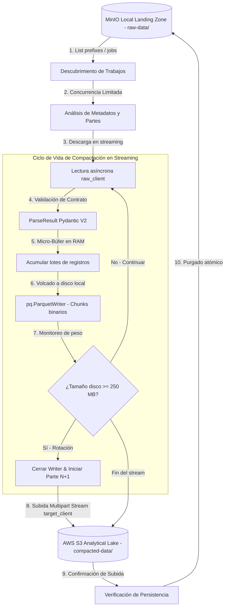

# Jobs — Catálogo de Trabajos Programados y Procesamiento Batch

El módulo de **Jobs** es un contenedor extensible diseñado para alojar tareas programadas, scripts de mantenimiento, procesos de ETL y cualquier tarea batch periódica necesaria para la plataforma de scraping distribuido. 

Este directorio está diseñado para crecer de forma modular, permitiendo añadir nuevos scripts independientes sin interferir con la lógica de los trabajos existentes.

---

## 📂 Estructura del Módulo

Cualquier nuevo script batch debe colocarse en la raíz de este módulo y definir sus propios esquemas o interfaces dentro de las carpetas correspondientes:

```text
jobs/
├── config/              # Parámetros y variables de entorno globales (Dual S3 clients)
├── interfaces/          # Modelos de validación (Pydantic) específicos de cada job
├── test/                # Suite de pruebas unitarias e integración de los jobs (10 tests)
├── Dockerfile           # Imagen Docker ligera dedicada para ejecución de Jobs en Kubernetes
├── pyproject.toml       # Dependencias y configuración de uv para el paquete jobs
├── README.md            # Documentación general y catálogo de jobs
└── compact_s3.py        # [Job] Compactador de Data Lake con Almacenamiento Escalonado
```

---

## 📖 Catálogo de Jobs Activos

---

### 1. Compactador de Data Lake con Almacenamiento Escalonado (`compact_s3.py`)

Este job es responsable de mitigar el **problema de los archivos pequeños** (*Small Files Problem*) mediante una arquitectura de **Almacenamiento Escalonado (Tiered Storage)**. 

Consolida los micro-ficheros JSON Lines generados por los workers en la Landing Zone local de **MinIO** (a coste 0€ en VPS Hetzner o clúster K8s), los transforma a formato columnar estructurado de alta densidad (**Apache Parquet**) con compresión **ZSTD** y los sube mediante multipart stream al Data Lake analítico destino (**AWS S3** o bucket centralizado). Tras confirmar la persistencia exitosa del Parquet, ejecuta un purgado atómico (*Delete-on-Success*) sobre MinIO para mantener el uso de disco del VPS acotado.

#### 🏗️ Arquitectura Dual-Target del Job de Compactación

El proceso se ejecuta de manera asíncrona concurrente con `asyncio` utilizando clientes independientes para la zona cruda de entrada (`raw_client`) y la zona analítica de salida (`target_client`):



#### 🚀 Características Clave del Job
* **Arquitectura de Doble Factoría S3 (`RAW_S3_*` vs `TARGET_S3_*`)**: Desacopla por completo el almacenamiento local de ingestión rápida (MinIO) del almacenamiento analítico de largo plazo (AWS S3), eliminando el 100% de las transacciones API Tier 1 en AWS S3 causadas por las escrituras frecuentes de los workers.
* **Política Delete-on-Success (`delete_raw_after_compaction`)**: Los fragmentos JSONL solo se eliminan de MinIO una vez que el archivo Parquet ha sido validado y persistido en AWS S3, garantizando tolerancia total a fallos sin pérdida de datos.
* **Escritura Incremental en Disco Local (RAM Plana)**: En lugar de cargar millones de registros en memoria virtual de Python (Heap Inflation), el job escribe bloques binarios de registros a disco temporal usando `pq.ParquetWriter`. Esto mantiene el consumo de RAM constante por debajo de los **60 MB** independientemente del volumen total procesado.
* **Corte por Tamaño de Archivo Real**: El script monitorea el tamaño físico del archivo binario Parquet en disco (`os.path.getsize()`). Cuando cruza los **250 MB**, cierra el escritor y lo sube asíncronamente como la *Parte N*, abriendo un nuevo archivo temporal local para continuar.
* **Subida por Stream (Zero Heap Upload)**: Al subir los archivos Parquet mediante `target_client.put_object(Body=file_object)`, el payload se transmite directamente desde el disco sin saturar la memoria RAM.
* **Esquema Resiliente Columnar**: Estructura las consultas mediante tipado fuerte en las columnas de control analítico (`task_id`, `job_id`, `url`, `scraped_at`), y empaqueta el contenido útil polimórfico en una columna `data` de tipo cadena JSON para prevenir roturas ante cambios en los campos extraídos de la web.

---

### 2. [Futuros Jobs] (Mantenimiento, Backups, Cargas ETL, etc.)
Para añadir un nuevo Job:
1. Crea tu archivo script en la raíz de `jobs/` (ej. `limpieza_temporales.py`).
2. Agrega las configuraciones necesarias en [`jobs/config/settings.py`](config/settings.py).
3. Añade su descripción técnica y su flujo en este catálogo para mantener la visibilidad arquitectónica del sistema.

---

## ⚙️ Configuración y Variables de Entorno Globales

El módulo comparte un objeto centralizado de configuración mediante `jobs/config/settings.py` alimentado por el archivo `.env`:

| Variable | Tipo | Por Defecto | Descripción |
| :--- | :--- | :--- | :--- |
| **Origen Crudo (Landing Zone - MinIO Local)** | | | |
| `RAW_S3_ENDPOINT_URL` | String | `http://localhost:4566` | Endpoint de la Landing Zone de entrada (MinIO / Emulador local). |
| `RAW_S3_BUCKET_NAME` | String | `scraping-data-lake` | Nombre del bucket de entrada para archivos JSONL. |
| `RAW_S3_REGION` | String | `us-east-1` | Región del servicio S3 crudo. |
| `RAW_AWS_ACCESS_KEY_ID` | String | `test` | Credencial de acceso a MinIO / Landing Zone. |
| `RAW_AWS_SECRET_ACCESS_KEY` | String | `test` | Credencial secreta de acceso a MinIO / Landing Zone. |
| **Destino Analítico (Analytical Lake - AWS S3)** | | | |
| `TARGET_S3_ENDPOINT_URL` | String | `http://localhost:4566` | Endpoint del Data Lake analítico de destino (AWS S3 Cloud o emulador). |
| `TARGET_S3_BUCKET_NAME` | String | `scraping-data-lake` | Nombre del bucket analítico de destino. |
| `TARGET_S3_REGION` | String | `auto` | Región del Data Lake analítico de destino (`auto` para Cloudflare R2, región AWS para AWS S3). |
| `TARGET_S3_ACCESS_KEY_ID` | String | `None` | Credencial de acceso para S3 / Cloudflare R2 destino (32 caracteres en R2). |
| `TARGET_S3_SECRET_ACCESS_KEY` | String | `None` | Credencial secreta de acceso para S3 / Cloudflare R2 destino (64 caracteres en R2). |
| **Gestión de Ciclo de Vida y Prefijos** | | | |
| `S3_PREFIX_RAW_DATA` | String | `raw-data` | Prefijo virtual de entrada para fragmentos crudos. |
| `S3_PREFIX_COMPACTED_DATA` | String | `compacted-data` | Prefijo virtual de destino para datasets Parquet ZSTD. |
| `DELETE_RAW_AFTER_COMPACTION` | Boolean | `True` | Si es `True`, purga de MinIO los fragmentos JSONL tras subida exitosa del Parquet. |
| `RAW_DATA_RETENTION_DAYS` | Integer | `7` | Días de retención TTL de contingencia para datos crudos. |

---

## 🛠️ Ejecución y Suite de Pruebas

### 1. Ejecución Automática en Kubernetes (CronJob)
El compactador está desplegado como un `CronJob` de Kubernetes (`infra/k8s/09-cronjob-compactor.yaml`) que se dispara automáticamente cada 4 horas (`0 */4 * * *`):
```bash
# Comprobar el estado del CronJob
kubectl get cronjob -n web-scraping-distributed

# Lanzar una ejecución manual puntual en el clúster
kubectl create job --from=cronjob/data-lake-compactor manual-compaction-test -n web-scraping-distributed
```

### 2. Lanzamiento Local Manual
Los jobs se invocan de forma independiente desde su raíz usando el gestor de dependencias `uv`:
```bash
# Lanzar el compactador de S3 localmente
uv run compact_s3.py
```

### 3. Batería de Pruebas Integradas
Las pruebas se localizan en `jobs/test/` y simulan la infraestructura AWS usando `ThreadedMotoServer` en memoria para persistencia de sockets y aislamiento absoluto:
```bash
# Ejecutar los 10 tests del módulo
uv run pytest

# Inspeccionar reporte de cobertura de código
uv run pytest --cov=. --cov-report=term-missing
```
