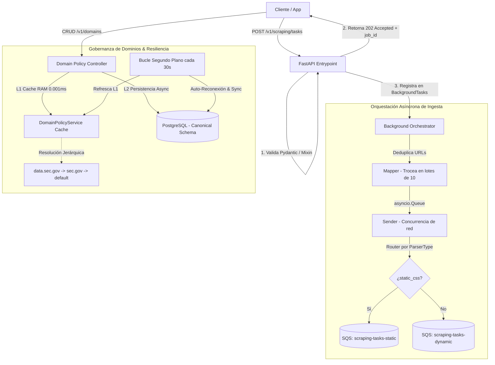

# Producer — API de Ingesta Asíncrona "Fire and Forget" & Gobernanza de Dominios

Microservicio de alto rendimiento desarrollado con **FastAPI** diseñado para:
1. Recibir solicitudes masivas de scraping, validarlas en tiempo real contra contratos Pydantic V2 y despacharlas de forma asíncrona hacia SQS mediante el patrón "Fire and Forget" (`202 Accepted`).
2. Centralizar la **Gobernanza de Dominios y Compliance Legal** mediante endpoints REST dedicados (`/v1/domains`), gestionando una caché L1 ultrarrápida en memoria (0.001 ms) con persistencia L2 en **PostgreSQL**.

> 📖 **Guía Completa de Uso de la API:** Consulta el [Manual Detallado de Uso de la API Producer](API_USAGE_GUIDE.md) para ejemplos paso a paso, contratos `FieldSpec`, contenedores `container` y opciones dinámicas de Playwright.

---

## 📌 Arquitectura y Patrones de Diseño

El Producer está concebido bajo el principio de **desacoplamiento total, procesamiento no bloqueante y resiliencia autónoma**.



### 1. Patrón "Fire and Forget" (202 Accepted)
- Valida los esquemas de entrada de forma síncrona en la API.
- Si es válido, delega el procesamiento y envío a la cola a `BackgroundTasks` de FastAPI.
- Responde inmediatamente con un código de estado `202 Accepted` y el `job_id` asociado.

### 2. Gobernanza de Dominios y Persistencia L1/L2
- **Caché L1 en Memoria (0.001 ms)**: Permite consultar límites de tasa y políticas en nanosegundos sin generar contención en la base de datos.
- **Resolución Jerárquica de Subdominios**: Si una tarea apunta a `data.sec.gov/filings`, el resolvedor evalúa primero la regla específica del subdominio; si no existe, asciende recursivamente a `sec.gov`, y en última instancia a la directiva global `default`.
- **Persistencia L2 en PostgreSQL**: Almacena las directivas de forma persistente. Si la base de datos se encuentra temporalmente caída, el servicio activa el modo degradado resiliente (continúa operando y respondiendo en memoria) y un bucle autónomo en segundo plano (`_background_db_health_and_sync`) reintenta la conexión cada 30 segundos sin interrumpir el servicio.

### 3. Pipeline de Encolado Concurrente (`mapper` ➡️ `sender`)
- **Mapper**: Trocea la carga masiva en lotes de 10 mensajes (límite de la API de SQS) y asigna un identificador único `batch_id`.
- **Sender & Semáforo de Red**: Controla la concurrencia a nivel de socket mediante `asyncio.Semaphore(20)`, evitando la saturación de sockets de red y protegiendo contra rate limits de AWS.

---

## ⚡ Optimización de Red en AWS SQS

- **Pool HTTP Ajustado**: Configura `Config(max_pool_connections=250)` sobre la sesión de `aioboto3`.
- **Reutilización Singleton Asíncrono**: El cliente SQS se inicializa una sola vez en el `lifespan` de FastAPI, reutilizando conexiones TCP/TLS activas.
- **Gestión de Fallos Parciales**: Discierne fallos recuperables vs fatales basándose en la respuesta `Failed` y la marca `SenderFault` de AWS.

---

## 🛠️ Configuración y Variables de Entorno

El microservicio lee sus opciones desde el archivo `.env` en la raíz del proyecto:

| Variable | Tipo | Por Defecto | Descripción |
| :--- | :--- | :--- | :--- |
| **Servicio API & SQS** | | | |
| `PRODUCER_PORT` | `int` | `8000` | Puerto de escucha de la API |
| `PRODUCER_HOST` | `str` | `0.0.0.0` | Host para enlazar el servidor ASGI |
| `DEBUG_MODE` | `bool` | `True` | Activa/Desactiva el modo recarga automática (`reload`) |
| `NUM_MAX_TASKS` | `int` | `10` | Tamaño máximo de lotes enviados a SQS (máx 10) |
| `DEFAULT_REGION_AWS` | `str` | `us-east-1` | Región de AWS para las colas |
| `SQS_ENDPOINT_URL` | `str` | `http://localhost:4566` | URL local del emulador de AWS SQS (Floci / LocalStack) |
| `SQS_QUEUE_URL` | `str` | `...` | URL de la cola principal para tareas estáticas |
| `SQS_QUEUE_URL_DYNAMIC` | `str` | `...` | URL de la cola principal para tareas dinámicas |
| **Base de Datos PostgreSQL (Gobernanza)** | | | |
| `POSTGRES_HOST` | `str` | `localhost` | Host del servidor PostgreSQL |
| `POSTGRES_PORT` | `int` | `5432` | Puerto del servidor PostgreSQL |
| `POSTGRES_USER` | `str` | `postgres` | Usuario de autenticación |
| `POSTGRES_PASSWORD` | `str` | `postgres` | Contraseña de autenticación |
| `POSTGRES_DB` | `str` | `webscraping_db` | Nombre de la base de datos canónica |

---

## 🛣️ Endpoints de la API

### 1. Ingesta de Tareas: `POST /v1/scraping/tasks`

Encola de forma asíncrona un lote de tareas de scraping con respuesta inmediata `202 Accepted`. Soporta metadatos de contexto jerárquicos (`context` a nivel de lote y específico por tarea) que se propagan hasta el almacenamiento analítico final en S3 / Parquet.

#### Ejemplo de Cuerpo de Petición con Contexto Jerárquico:
```json
{
  "job_id": "sec-edgar-filings-2026",
  "context": {
    "source": "sec_edgar",
    "dataset": "historical_8k",
    "fiscal_year": 2024
  },
  "tasks": [
    {
      "url": "https://www.sec.gov/Archives/edgar/data/320193/000032019324000106/aapl-20241031.htm",
      "parser_type": "static_css",
      "parser_config": {
        "selectors": {
          "titulo": "title",
          "contenido": "body"
        }
      },
      "headers": {
        "User-Agent": "InvestigacionAcademica contacto@miuniversidad.edu"
      },
      "priority": 5,
      "max_retries": 3,
      "context": {
        "ticker": "AAPL",
        "cik": "0000320193",
        "accession_number": "0000320193-24-000106",
        "fiscal_year": 2023
      }
    }
  ]
}
```
> [!NOTE]
> **Fusión y Precedencia de Contexto:** El contexto global actúa como base (`source`, `dataset`). Si la tarea define una clave colisionante (ej: `"fiscal_year": 2023`), la tarea individual prevalece sobre el global. Si no se envía contexto, ambos campos admiten `null` de forma segura.

#### Respuesta (`202 Accepted`):
```json
{
  "job_id": "sec-edgar-filings-2026",
  "status": "accepted",
  "message": "El procesamiento ha comenzado en segundo plano."
}
```

---

### 2. Gobernanza de Dominios: `/v1/domains`

Endpoints REST para administración en caliente de directivas de scraping por dominio:

* `GET /v1/domains`: Lista todas las políticas de dominio configuradas con conteo total.
* `GET /v1/domains/{domain}`: Obtiene la política específica aplicada a un dominio (ej. `sec.gov`).
* `PUT /v1/domains/{domain}`: Crea o actualiza en caliente los parámetros de una política (rate limit, proxies, cabeceras).
* `DELETE /v1/domains/{domain}`: Elimina la política de un dominio (la política `default` está protegida y no puede eliminarse).

#### Ejemplo: Configurar Política Estricta para la SEC (`PUT /v1/domains/sec.gov`):
```json
{
  "hard_rate_limit": 10.0,
  "default_rate_limit": 5.0,
  "default_use_proxy": false,
  "default_respect_robots_txt": true,
  "default_headers": {
    "User-Agent": "InvestigacionAcademica contacto@miuniversidad.edu",
    "Accept-Encoding": "gzip, deflate"
  },
  "description": "Cumplimiento estricto con las directrices de la SEC EDGAR (máx 10 req/s, sin proxies comerciales)"
}
```

---

## 🧪 Pruebas Unitarias, Integración y Calidad (SonarCloud)

La suite de pruebas del Producer valida los contratos Pydantic, la orquestación SQS, la capa de persistencia PostgreSQL y la resiliencia en modo degradado.

```bash
cd producer
uv sync

# Ejecutar la suite completa (25 tests)
uv run pytest

# Verificar cobertura de código (98% total)
uv run pytest --cov=producer --cov-report=term-missing
```

Estado de calidad actual: **25/25 tests pasando** con **98% de cobertura de código**, superando holgadamente el Quality Gate del 80% de SonarCloud.
