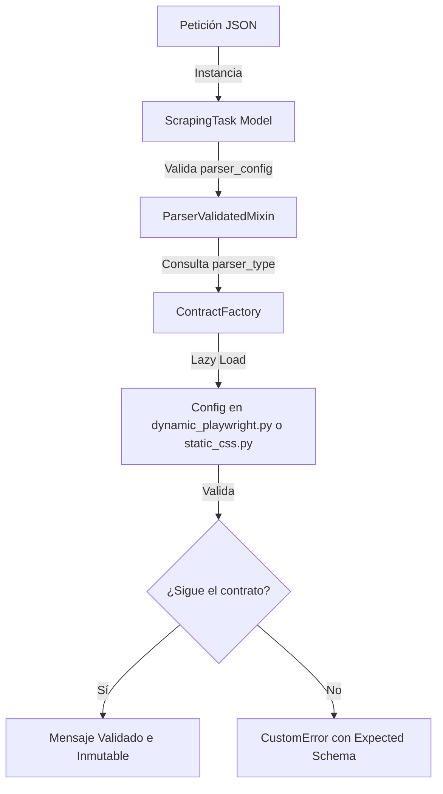

# Shared — Biblioteca de Modelos y Utilidades Comunes

Módulo centralizador de contratos de datos, validaciones contractuales, políticas de gobernanza y utilidades transversales que proporciona cohesión arquitectónica y desacoplamiento en el sistema de scraping distribuido.

Este paquete es compartido e integrado de forma nativa por el **Producer** (para validar en la ingesta y gestionar dominios) y el **Worker** (para procesar, validar robots.txt y aplicar rate limiting).

---

## 📌 Propósito y Arquitectura

En sistemas distribuidos orientados a eventos, la **coherencia del contrato** es crítica. Si el productor envía un mensaje con una estructura que el consumidor no puede entender, el sistema falla de manera silenciosa.

`shared` resuelve esto actuando como la **única fuente de verdad** (*Single Source of Truth*), garantizando que:
1. Toda tarea de scraping que viaje por SQS cumpla estrictamente el mismo esquema validado por **Pydantic V2**.
2. Las políticas de gobernanza de dominios (`DomainPolicy`), rate limits estrictos y cumplimiento de `robots.txt` compartan contratos idénticos.
3. Las configuraciones dinámicas de extracción (selectores CSS, `FieldSpec`) se validan antes de entrar en la cola.
4. El sistema de logging sea uniforme, estructurado en JSON para observabilidad en la nube y resistente a fallos de serialización.

---

## 📁 Estructura del Módulo

```py
shared/
├── pyproject.toml                  # Configuración de empaquetado (Hatchling) y dependencias
├── README.md                       # Esta documentación
└── shared/                         # Código fuente del paquete
    ├── __init__.py                 # Exportaciones públicas de modelos y utilidades
    ├── logging.py                  # Logger unificado, estructurado y resiliente
    └── models/                     # Contratos de datos tipados (Pydantic V2)
        ├── __init__.py
        ├── scraping_task.py        # Modelo y contrato del mensaje SQS (ScrapingTask)
        ├── batch_task_response.py  # Modelos de respuesta REST para lotes
        ├── domain_policy.py        # Modelos DTO de Gobernanza de Dominios (CRUD)
        ├── robots_status.py        # Enum de estados de evaluación de robots.txt
        ├── parse_type/             # Tipos y motores de scraping soportados
        │   ├── __init__.py
        │   └── enum.py             # Enum de ParserType (static_css, dynamic_playwright)
        └── parse_config/           # Validación contractual y perezosa de motores
            ├── __init__.py
            ├── base.py             # Clase base inmutable (BaseParserConfig, FieldSpec)
            ├── factory.py          # Factory para carga perezosa de configuraciones
            ├── validators.py       # Mixin interceptor de validación dinámica
            ├── static_css.py       # Contrato específico del motor Static CSS
            └── dynamic_playwright.py # Contrato específico del motor Dynamic Playwright
```

---

## 🛠️ Componentes Clave

### 1. Contratos de Datos Estrictos (`shared.models`)

#### `ScrapingTask`
Es el modelo de datos principal que representa una tarea individual en la cola de mensajería SQS.

```python
from shared.models import ScrapingTask

# Estructura del contrato de mensajería SQS:
# - task_id: UUID de trazabilidad y de-duplicación.
# - batch_id / job_id: Agrupadores de lotes de scraping.
# - url: URL válida a extraer (HttpUrl).
# - parser_type: Motor a utilizar (Enum ParserType).
# - parser_config: Diccionario con la configuración del parser.
# - priority: Prioridad de ejecución (1 a 10).
# - retry_count / max_retries: Control de reintentos y tolerancia a fallos.
# - context: Metadatos combinados (global + tarea con precedencia) que viajan hasta S3/Parquet.
```

#### Gobernanza y Políticas de Dominio (`DomainPolicy`)
Modelos para controlar la velocidad, uso de proxy y cumplimiento legal por cada dominio:

* **`DomainPolicyBase`**: Validación de dominio normalizado (minúsculas, sin puertos) y coherencia entre `default_rate_limit` y `hard_rate_limit`.
* **`DomainPolicyCreate` / `DomainPolicyUpdate`**: DTOs para la API REST del Producer con validaciones de rangos y campos opcionales.
* **`DomainPolicy`**: Entidad persistible completa con marcas temporales UTC (`created_at`, `updated_at`).
* **`RobotsStatus`**: Estados del evaluador normativo RFC 9309 (`BYPASS`, `ALLOWED`, `NOT_FOUND`, `DISALLOWED`).

```python
from shared.models import DomainPolicy, RobotsStatus

# Ejemplo de política para SEC EDGAR
policy = DomainPolicy(
    domain="sec.gov",
    hard_rate_limit=10.0,        # Límite infranqueable de 10 req/s exigido por la SEC
    default_rate_limit=5.0,
    default_use_proxy=False,     # IP directa limpia (coste 0€)
    default_respect_robots_txt=True,
    default_headers={"User-Agent": "MyResearchLab contact@lab.edu"}
)
```

---

### 2. Validación Dinámica de Contratos (Factory + Mixin)

Cada motor de scraping requiere parámetros distintos:
* `static_css`: requiere selectores CSS obligatorios (`selectors`).
* `dynamic_playwright`: requiere selectores y parámetros de interacción opcionales (tales como `timeout_ms`, `wait_until`, `wait_for_selector`, `scroll_to_bottom`, `click_selectors`).



- **`BaseParserConfig`**: Define las reglas para los submódulos. Es inmutable (`frozen=True`) para proteger los hilos de ejecución concurrentes y no permite campos ajenos (`extra='forbid'`).
- **`FieldSpec`**: Especificación granular de extracción:
  ```python
  class FieldSpec(BaseModel):
      selector: str
      attribute: str | None = None   # Atributo HTML a extraer (ej: 'href', 'src')
      default: Any | None = None
      multiple: bool = False         # Retorna lista si es True dentro de un contenedor
  ```
- **`ContractFactory`**: Implementa **Carga Perezosa (Lazy Load)**. Importa dinámicamente el submódulo correspondiente en tiempo de ejecución.

---

### 3. Logger Unificado y Estructurado (`shared.logging`)

El sistema incluye una clase de logging altamente optimizada para desarrollo local y entornos en la nube:

- **Formateado Coloreado (`StyleFormatter`)**: Muestra logs estructurados legibles con realce de colores ANSI según la severidad (`INFO`, `WARNING`, `ERROR`, `DEBUG`) en la terminal local.
- **Contexto JSON Enriquecido**: Permite adjuntar diccionarios de metadatos a los mensajes de log de forma limpia:
  ```python
  logger.info("Tarea encolada con éxito", context={"task_id": "123", "priority": 5})
  ```
- **Tolerancia Extrema a Fallos**: El logger implementa un serializador universal (`_universal_serializer`) adaptado para serializar de manera segura objetos complejos, Pydantic, fechas, UUIDs y Decimales sin provocar caídas del microservicio.

---

## 📥 Instalación en Desarrollo Local

Con el gestor **uv** en la raíz del proyecto, las dependencias del workspace se sincronizan de forma automática en los entornos virtuales de los microservicios:

```bash
# Sincronizar dependencias locales en el microservicio
cd producer
uv sync
```

O si deseas forzar la reinstalación del paquete local shared:
```bash
uv sync --reinstall-package shared
```
