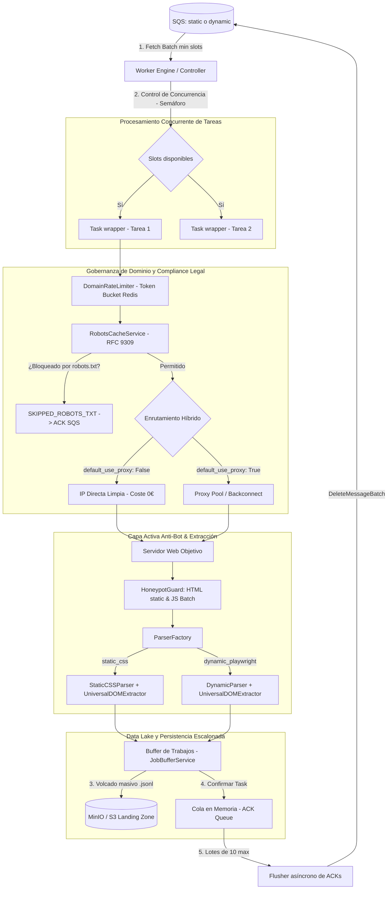
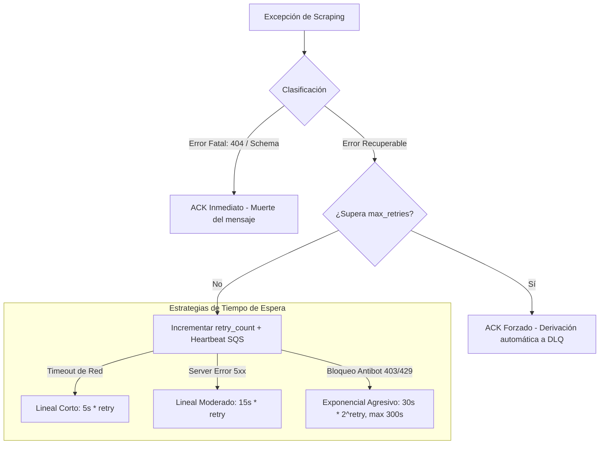

# Worker — Motor Concurrente de Extracción, Gobernanza y Resiliencia

El **Worker** es el núcleo de ejecución asíncrono y de alto rendimiento del sistema. Su responsabilidad es consumir tareas de scraping de Amazon SQS, garantizar el cumplimiento legal y normativo (**RFC 9309 robots.txt**), aplicar limitación de tasa distribuida (**Token Bucket en Redis**), evadir bloqueos de red mediante enrutamiento híbrido de proxies, extraer los datos estructurados con `UniversalDOMExtractor` y gestionar la tolerancia a fallos mediante backoff dinámico y drenado de RAM.

---

## 🏗️ Arquitectura del Motor de Ejecución

El Worker está diseñado bajo un enfoque **no bloqueante y concurrente** utilizando `asyncio` y clientes de red nativos (`curl_cffi` para peticiones estáticas impersonadas y `Playwright Chromium` para contenido dinámico SPA).



---

## 🛡️ Gobernanza de Dominio, Rate Limiting y Compliance Legal

El Worker incorpora mecanismos estrictos de cumplimiento legal y protección de infraestructura:

### 1. Token Bucket Distribuido (`DomainRateLimiter`)
- Implementa un limitador de tasa token bucket granular por dominio (`hard_rate_limit` y `default_rate_limit`).
- **Estado Atómico en Redis**: Los contadores de tokens se coordinan de forma distribuida entre múltiples réplicas de workers en Redis mediante adaptadores pasivos (`RedisCacheAdapter`).
- **Contingencia Local en RAM (`MemoryCacheAdapter`)**: Si Redis no está disponible o sufre una caída temporal, conmuta automáticamente a una caché en memoria local sin interrumpir el flujo de extracción ni violar las tasas límite.

### 2. Cumplimiento Normativo RFC 9309 (`RobotsCacheService`)
- Inspecciona de forma preventiva el archivo `robots.txt` del dominio antes de realizar cualquier extracción.
- **Caché TTL de 24 horas**: Almacena el árbol de reglas en Redis para evitar peticiones repetitivas al servidor web de destino.
- Si una URL está desautorizada explícitamente para el `User-Agent` del scraper, el Worker finaliza la tarea con estado `SKIPPED_ROBOTS_TXT`, registra el motivo y emite un ACK inmediato a SQS para no consumir recursos innecesarios.

### 3. Enrutamiento Híbrido de Proxies
- **Coste 0€ en Dominios Públicos / Institucionales**: Para orígenes regulados con APIs públicas o directrices abiertas (como la SEC EDGAR de EE.UU.), las peticiones se enrutan a través de la interfaz de red directa y limpia del worker (`default_use_proxy = False`), evitando el coste de proxies residenciales comerciales.
- **Rotación Residencial / Sticky Sessions**: Para dominios protegidos, canaliza el tráfico a través de gateways residenciales (`backconnect`) o rotación en pool estático con afinidad por sesión (`sticky_session_id`).

---

## 🚀 Motor Dinámico Playwright & Gestión de Recursos V8

El motor dinámico (`DynamicParser`) permite renderizar aplicaciones SPA y JavaScript complejo garantizando estabilidad de memoria RAM:

- **Reciclaje Automático por Contador de Tareas**: Tras procesar 25 tareas (`playwright_max_tasks_per_browser`), el Worker auto-destruye y reinicia el proceso Chromium de fondo, ejecutando `gc.collect()` para liberar fugas de memoria del motor V8.
- **Límite Estricto V8 Heap (RAM)**: Inyecta banderas de arranque en Chromium (`--js-flags=--max-old-space-size=512`, `--disable-gpu`, `--disable-software-rasterizer`) limitando la RAM asignable por pestaña a **512 MB**.
- **Coherencia de Client Hints**: Inyecta dinámicamente cabeceras de contexto (`Sec-Ch-Ua-Platform: "Windows"`) y versionado real de Chromium para eliminar inconsistencias entre el sistema operativo host del contenedor y el navegador.
- **Inspección Batch JS Honeypot**: Evalúa trampas HTML invisibles en Chromium ejecutando una única función JavaScript en V8 (`~15 ms`).

---

## 🛡️ Tolerancia a Fallos y Backoff Dinámico

El scraping web está expuesto a fallos constantes de red. El Worker clasifica las excepciones para responder de manera inteligente mediante el recalculo del **Visibility Timeout** del mensaje en SQS:



- **Errores Fatales** (`NOT_FOUND`, `INVALID_SCHEMA`): Se consideran no recuperables. El Worker emite un ACK forzado de inmediato para eliminar el mensaje de la cola.
- **Errores Recuperables** (`TIMEOUT`, `SERVER_ERROR`, `BLOCKED`):
  - Modifican el tiempo de visibilidad en SQS según la severidad del fallo.
  - Al superar `max_retries`, se descartan de la cola principal y se trasladan automáticamente a la Dead Letter Queue (DLQ).

---

## ⚙️ Protocolo de Apagado Seguro (Graceful Shutdown)

El Worker captura señales del sistema operativo (`SIGINT`, `SIGTERM`) para garantizar cero pérdida de datos:
1. Pone `running = False` para detener el polling de mensajes en SQS.
2. Espera la finalización limpia de las tareas en vuelo vinculadas al semáforo.
3. Ejecuta un **drenado de RAM a almacenamiento (`JobBufferService.flush()`)**, volcando los micro-lotes JSONL a la Landing Zone (MinIO / S3).
4. Procesa y vacía la cola de confirmaciones de borrado de SQS (`_ack_flusher`) en lotes de hasta 10 mensajes.
5. Cierra las conexiones activas de red y sockets de clientes.

---

## 🛠️ Configuración y Variables de Entorno

El comportamiento del Worker se controla mediante `config/settings.py` alimentado por el archivo `.env`:

| Variable | Tipo | Por Defecto | Descripción |
| :--- | :--- | :--- | :--- |
| **Concurrencia & SQS** | | | |
| `WORKER_NUM_MAX_CONCURRENT_TASKS` | `int` | `10` | Concurrencia máxima (Semáforo) por réplica de Worker |
| `NUM_MAX_TASKS` | `int` | `10` | Lote máximo de lectura y borrado en SQS (máx 10) |
| `SQS_ENDPOINT_URL` | `str` | `http://localhost:4566` | Endpoint del broker SQS (LocalStack / Floci / AWS) |
| `SQS_QUEUE_URL` | `str` | `...` | URL física de la cola SQS consumida (estática o dinámica) |
| `DEFAULT_REGION_AWS` | `str` | `us-east-1` | Región AWS por defecto del sistema |
| **Landing Zone de Almacenamiento (MinIO / S3)** | | | |
| `S3_ENDPOINT_URL` | `str` | `http://localhost:9000` | Endpoint de la Landing Zone de almacenamiento |
| `S3_BUCKET_NAME` | `str` | `scraping-data-lake` | Nombre del bucket destino (Data Sink) |
| `S3_PREFIX_RAW_DATA` | `str` | `raw-data` | Prefijo virtual de S3 para datos crudos JSONL |
| **Gobernanza & Redis** | | | |
| `REDIS_HOST` | `str` | `localhost` | Host de Redis para Token Bucket y caché de robots.txt |
| `REDIS_PORT` | `int` | `6379` | Puerto de conexión a Redis |
| `REDIS_PASSWORD` | `str` | `""` | Contraseña opcional de Redis |
| `REDIS_DB` | `int` | `0` | Base de datos lógica de Redis |
| **Renderizado Dinámico Playwright** | | | |
| `PLAYWRIGHT_MAX_TASKS_PER_BROWSER` | `int` | `25` | Reciclaje automático de Chromium cada N tareas procesadas |
| `PLAYWRIGHT_V8_MAX_OLD_SPACE_SIZE_MB` | `int` | `512` | Límite máximo de Heap JS por pestaña Chromium en MB |
| **Proxies de Red** | | | |
| `PROXY_ENABLED` | `bool` | `False` | Activa/Desactiva el uso de proxies de red |
| `PROXY_MODE` | `str` | `static_pool` | Modo de proxies (`static_pool` o `backconnect`) |
| `PROXY_STATIC_LIST` | `str` | `""` | Lista de proxies estáticos separados por comas |
| `PROXY_URL` | `str` | `""` | Dirección completa del gateway backconnect residencial |

---

## 🚀 Cómo Empezar a Desarrollar

### 1. Instalación de dependencias locales
```bash
cd worker
uv sync
```

### 2. Ejecución en desarrollo
Para arrancar el consumidor de colas estáticas:
```bash
SQS_QUEUE_URL=http://localhost:4566/000000000000/scraping-tasks-static uv run python main.py
```

Para arrancar el consumidor de colas dinámicas (Playwright):
```bash
SQS_QUEUE_URL=http://localhost:4566/000000000000/scraping-tasks-dynamic uv run python main.py
```

### 3. Ejecutar la Suite de Pruebas
El Worker incluye **84 pruebas unitarias e integradas asíncronas** con simulación completa de SQS, S3 (Moto), Redis, robots.txt y motores de parseo:
```bash
uv run pytest
```
